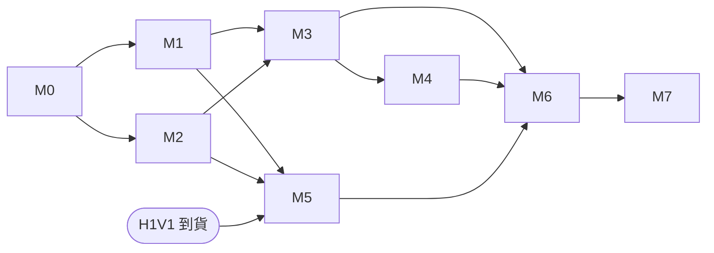

# 開發板（H1V1）Roadmap

> 整理日期：2026-11-24。規格在 [dev_board_spec.md](dev_board_spec.md)（`§`），要各組回答的題目在 [discussion.md](discussion.md)（A、S、P、G 題號）。
>
> - H1V1 到貨日和 demo 日都還沒有確切日期，只知道**到手到 demo 約 2～4 週**。所以用階段和「到貨日 T」排，拿到日期再填進第 5 節。
> - 階段的切法、工作順序、時程和縮減順序是**提議**；規則和參數以 spec 為準。

## 1. 總覽

| 階段 | 做什麼 | 需要什麼 | 完成的標準 |
| ---- | ------ | -------- | ---------- |
| M0 準備 | 發題目、拿工具鏈、建專案 | 無 | 題目已發出，PC 上能編譯和跑測試 |
| M1 演算法 | 前處理、`evaluate`、推薦、確認 | M0 | 單元測試和合成深度的場景通過 |
| M2 通訊 | TCP、MAVLink、UDP＋JSON、回放程式 | M0 | 用回放程式跑完整流程，異常情況都照 spec 回報 |
| M3 橋接＋Gazebo | 橋接程式、實跑查證、錄檔 | M1、M2、Gazebo 組的環境 | 真的 Gazebo 深度跑得通，座標誤差 < 0.15 m |
| M4 定參數 | r、坡度、σz、R、k 的實驗 | M3、Gazebo 場景、箱子尺寸 | §11 的 `?` 都有數字 |
| M5 上板 | 移植、打通、量效能 | M1、M2、**H1V1 到貨**、P4、A5 | H1V1 上結果跟 PC 一致，效能達標 |
| M6 聯調驗收 | 接 server／XR，跑 §14 | M3、M4、M5、server／XR | 達到 §14 的通過標準 |
| M7 Demo | 預演、備好錄檔 | M6 | 連續順利跑完 demo 流程 |

M3、M4 **不用等板子**，M5 **不用等 M3、M4**（可以先用回放程式打通）。板子到之前，做完越多 M1～M4 越好。

## 2. 板子到之前

### M0 準備（現在）

- [ ] 把 `discussion.md` 發給各組，先催第 4 節的題目
- [ ] 問清楚 H1V1 到貨日、demo 日
- [ ] 拿到 NT98690 的 SDK 和交叉編譯工具鏈，編出一個 TCP 測試程式（**最大的風險，先做**）
- [ ] 建專案：git、C++ 編譯設定、單元測試、c_library_v2、JSON 函式庫；確認這些函式庫也能交叉編譯
- [ ] 設定檔：§11 的參數全部可調，啟動時進位 `r`、`Zw`（§10）

### M1 演算法（PC，合成深度）

依序做，後面的要用前面的：

- [ ] 降採樣函式（§2），做成橋接程式和合成深度共用的函式庫
- [ ] 前處理：反投影、座標轉換、細格 Moments、`h20`、前綴和、無效像素（§5 第 3～7 步）
- [ ] 姿態和位置的內插、yaw 最短角度（§5 第 2 步）
- [ ] 高度 `agl`（§6.1）
- [ ] `evaluate`：規則 A～D（§6.2）
- [ ] 推薦：前置檢查、暴力搜尋、選點、輸出座標（§8.2～8.6）
- [ ] 排除清單：2 m、5 分鐘、`exclude_last`、sim time 倒退清空（§5、§8.8）
- [ ] drop_check：收 10 幀、`moving`、`drop_max_height`、合併（§7）
- [ ] 回放紀錄：存深度、姿態、判斷結果（§14）

**完成的標準**

- [ ] §14 的單元測試全過（深度轉換、4×4 中位數、`r`／`Zw` 進位、yaw 內插）
- [ ] 用合成深度跑 §14 的坑、裂縫、石頭、斜面、躺著的人（已知限制）、平地不同傾角：結果符合預期
- [ ] 0.5 m 小坑隨機 100 個位置漏判 ≤ 10%；平地 7.5 m 誤擋 ≤ 5%
- [ ] PC 上量推薦時間（只當參考，不能代表 H1V1）

### M2 通訊（PC，跟 M1 可以交錯做）

- [ ] TCP 深度接收：表頭、只留最新一幀、timeout、自動重連（§4）
- [ ] MAVLink 接收：`ATTITUDE`、`LOCAL_POSITION_NED`（含 vx、vy）（§4、§5）
- [ ] 資料過期：`no_depth`／`no_px4`（§5）
- [ ] UDP＋JSON：`ack`、重送、去重、`session_id`、結果快取、heartbeat（§9）
- [ ] 回放程式：用同樣格式送 TCP 深度和 MAVLink
- [ ] 假的 server：送 `suggest_request`／`check_request`，可以故意掉包

**完成的標準**（回放程式＋假 server）

- [ ] 推薦 → 確認 → 換一個，流程跑得完
- [ ] §14 的異常場景：沒資料、資料停掉、PX4 時間差 2 秒、15／16 重送、收幀途中再按、5 FPS、重啟任一邊
- [ ] §14 的回放場景：像素改成 0、8＋2／7＋3／4＋3＋3 幀

### M3 橋接＋Gazebo（在 Gazebo 組的電腦上）

- [ ] 橋接程式：訂閱深度 topic → 降採樣 → TCP（§4）
- [ ] 實跑查證（目前只查過原始碼）：z-depth（G1）、時間零點（P1）、固定雜訊有沒有作用在深度上（G7）
- [ ] 確認相機方向（G3）、相機和投放機構位置（G2a～G2c）、內參和 hfov（G4）
- [ ] 錄下各場景的深度和姿態，之後在自己的電腦回放

**完成的標準**

- [ ] 已知地標換算的 `north`／`east`：機頭轉向、1 m/s 飛行、相機偏移時的誤差都照 §14
- [ ] 平地高度場景：1.5／2／3／7.5／12／18／25 m 的回報照 §14
- [ ] 10 m 建築的四個位置：合格、`hole`、`hole`、合格
- [ ] 移動中按確認回 `moving`；重置、暫停 Gazebo 後能恢復

### M4 定參數（跟 Gazebo 組一起）

| 順序 | 參數 | 做法 | 需要 |
| ---- | ---- | ---- | ---- |
| 1 | 箱子尺寸、`Zw` | 全組決定 | A1 |
| 2 | σz、R | 平地加固定雜訊，量**降採樣後**的深度 | G7 |
| 3 | 坡度上限（暫定 10°） | 斜面上丟箱子 | 箱子模型 |
| 4 | 外圈寬 r | 從投放高度丟箱子，量落地偏移的 95 百分位 | A1、A2 |
| 5 | `drop_max_height`（5 m）、`moving`（0.3 m/s） | 跟 r 的實驗一起看 | 同上 |
| 6 | 鄰居圈數 k（預設 1） | 飛到指定點，量停下來的誤差 | A3 |

定完後重跑 M1 的合成場景，確認 r、R 改掉之後預期結果還成立。

## 3. 板子到之後（T = 到貨日）

### M5 上板

**第一天**：只求打通，不管效能

- [ ] 開機、登入、網路通
- [ ] 交叉編譯的程式跑得起來
- [ ] TCP 深度、UDP、MAVLink 各自收得到（先用回放程式，再接 Gazebo）

**接著**

- [ ] 同一份錄檔在 PC 和 H1V1 上的判斷結果一致
- [ ] 量效能：推薦 ≤ 1 秒、超過 200 ms 就優化（§8.7）；`height` ≥ 10 Hz；drop_check 約 1.5 秒內
- [ ] 拔網路線 10 秒、暫停 Gazebo 10 秒都能自動恢復

### M6 聯調驗收

- [ ] 接 server／XR：推薦、換一個、確認、高度、heartbeat
- [ ] XR 配合的四點：`ok` 過期清掉、`hole` 的文字、`moving`／`too_high` 的提示、開發板離線
- [ ] 重新投影的紅框在地標上（差 < 0.2 m，§8.5）
- [ ] §14 全部跑一次，記錄結果，達到通過標準（A4 全組同意後的數字）

### M7 Demo

- [ ] 決定 demo 流程：搜尋 → 推薦 → 飛過去 → 下降 → 確認 → 投放，加一個「不合格 → 換一個」
- [ ] 完整預演
- [ ] 錄下一次成功的完整流程。這不是替代 H1V1 的備案，只用來現場出狀況時說明

## 4. 各組的回答卡住哪一步

| 最晚何時要 | 題目 | 沒回答時先怎麼做 |
| ---------- | ---- | ---------------- |
| M2 結束前 | S1 server IP、port | 設定檔先用 localhost |
| M2 結束前 | S6 訊息變更可以嗎 | 照 spec §9 做 |
| M3 開始前 | G1～G5、G8、G10 | 照 `discussion.md` 的假設，M3 一起驗 |
| M3 開始前 | P1～P3 | 照 `LOCAL_POSITION_NED`、≥ 30 Hz、同零點 |
| M4 開始前 | A1 箱子尺寸、A2 高度、G7 雜訊、G9 場景由誰做 | A1、A2 用暫定值；**G7、G9 沒有就做不了 M4** |
| M4 的 k 實驗前 | A3 誰飛到推薦點 | k = 1 |
| T 之前 | P4 MAVLink 送到 H1V1、A5 IP 和 port | **沒有就打不通 HIL**；建議 mavlink-router |
| M6 開始前 | A4 驗收標準、S2 RGB 延遲、S3、S4、G6 | A4 用 §14 的提議；疊圖只在懸停時看 |

S5、P5 不影響開發板的進度，聯調前回答即可。

## 5. 時程

拿到確切日期後填這張表。

| 里程碑 | 日期 |
| ------ | ---- |
| H1V1 到貨（T） | 待填 |
| demo | 待填 |

T 之後怎麼分：

| 工作 | 只有 2 週 | 有 4 週 |
| ---- | --------- | ------- |
| M5 打通 | 第 1 天 | 第 1 天 |
| M5 移植、量效能 | 第 2～4 天 | 第 1 週 |
| M6 聯調 | 第 5～9 天 | 第 2 週 |
| M6 跑 §14、修問題 | 第 10～12 天 | 第 3 週 |
| M7 預演 | 第 13～14 天 | 第 4 週 |

檢查點：

- **T 當天**：M1、M2 要完成，不然 2 週的版本來不及
- **M6 開始時**：M3、M4 要完成；M4 沒完成就用暫定值驗收，並在結果註明

## 6. 風險

| 風險 | 影響 | 怎麼處理 |
| ---- | ---- | -------- |
| 工具鏈或 SDK 有問題 | 板子到了也跑不起來 | M0 就先編 TCP 測試程式；第三方函式庫選只有標頭檔的 |
| 板子晚到 | M5、M6 被壓縮 | 沒有備案（已決定）。M1～M4 照做；到貨日一有變動就跟全組說 |
| Gazebo 組的環境或場景晚到 | M3、M4 卡住 | M1、M2、M5 不受影響，參數先用暫定值 |
| Gazebo 版本不同，查證的結果不成立 | 深度或時間算錯 | M3 第一件事就驗 G1、P1、G7 |
| H1V1 跑推薦 > 200 ms | 回覆變慢 | 照 §8.7 優化；上限是 ≤ 1 秒 |
| 模擬跑不到 8 FPS | drop_check 一直回 `no_depth` | 改成 5 幀至少 4 幀（§11） |
| 訊息格式跟 server／XR 沒對齊 | M6 大改 | M2 完成後就把假 server 和 JSON 範例給他們對 |

## 7. 時間不夠時的縮減順序（提議）

從上往下砍：

1. 外圈滑動角檢查（spec 本來就是選做）
2. k 的實驗 → 用 1
3. `moving`、`drop_max_height` 的調校 → 用暫定值（功能要留）
4. 超過 200 ms 的優化 → 只要 ≤ 1 秒就先不做
5. 坡度和 r 的完整實驗 → 縮小次數，用暫定 10°、r = 0.5 m（§14 的基準）

**不能砍**：TCP 深度和 MAVLink 打通、`agl`、`evaluate`、推薦、drop_check、資料過期、H1V1 實測。

## 8. 不在這次範圍

- 障礙物判斷、全域地面、實體無人機（§1）
- 偵測躺在外圈的人（§12 已知限制）
- 隨距離變大的深度雜訊
- 比較「推薦當下」和「投放前」的深度（§7，待定）
